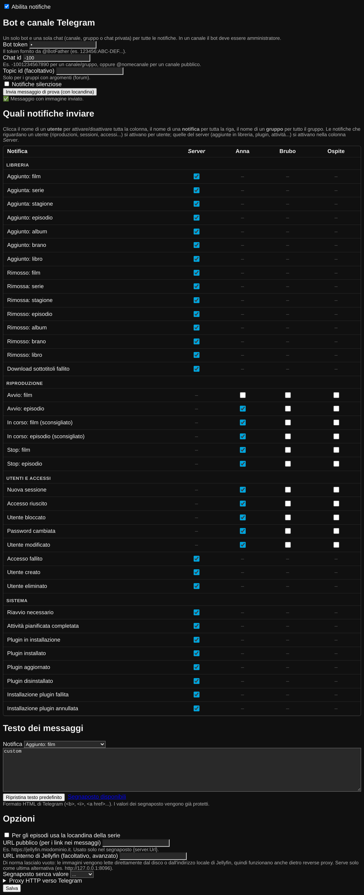

# Jellyfin Telegram Notifier (fork di brubo83)

Plugin per [Jellyfin](https://github.com/jellyfin) che invia notifiche su Telegram per quello che succede sul server:
riproduzioni, nuovi contenuti in libreria, accessi, plugin, attività pianificate e altro.

Questo è un fork di [RomainPierre7/jellyfin-plugin-TelegramNotifier](https://github.com/RomainPierre7/jellyfin-plugin-TelegramNotifier),
pensato per **monitorare il proprio server** e modificato così:

- **Funziona dietro reverse proxy** (nginx-proxy-manager, Traefik, Caddy...). L'originale scaricava le locandine dall'URL pubblico
  del server e, se non ci riusciva, scartava l'intera notifica. Ora le immagini vengono lette dal disco (o dall'indirizzo locale di
  Jellyfin) e caricate su Telegram. Se l'immagine non è disponibile, il messaggio arriva comunque senza foto.
- **Un solo bot e un solo canale** per tutte le notifiche.
- **Una matrice nelle impostazioni**: righe = tipi di notifica, colonne = utenti Jellyfin. Così, per esempio, puoi ricevere le
  riproduzioni di tutti tranne le tue. Clicca il nome di un utente per attivare/disattivare la colonna, il nome di una notifica per
  la riga, il nome di un gruppo per tutto il gruppo.
- **Testi in italiano** di default, modificabili dalla pagina delle impostazioni.
- Messaggi più robusti: titoli e trame con `<` o `&` non bloccano più l'invio, le didascalie troppo lunghe vengono accorciate,
  gli errori di Telegram compaiono nei log.



> [!NOTE]
> Il plugin usa lo stesso ID dell'originale: installandolo sostituisce Telegram Notifier e ne riprende bot token e chat id.
> Non tenere entrambi i repository nel catalogo di Jellyfin.

## Requisiti

- Jellyfin **10.11** o successivo
- Un bot Telegram e una chat, un gruppo o un canale dove il bot può scrivere

## Installazione dal catalogo di Jellyfin (consigliata)

1. Apri **Dashboard → Plugin → Catalogo** e clicca l'icona ⚙️ (**Repository**).
2. Se c'è il repository dell'originale (`RomainPierre7/.../manifest.json`), **rimuovilo**.
3. Aggiungi un repository:
   - Nome: `Telegram Notifier (brubo83)`
   - URL:
     ```
     https://raw.githubusercontent.com/brubo83/jellyfin-plugin-TelegramNotifier/main/manifest.json
     ```
4. Torna al **Catalogo**, cerca **Telegram Notifier** e clicca **Installa**.
   Se avevi già l'originale, comparirà come aggiornamento alla versione 13.
5. **Riavvia Jellyfin.**

Gli aggiornamenti futuri arriveranno dallo stesso catalogo.

## Installazione manuale

1. Scarica `TelegramNotifier.zip` dall'ultima [release](https://github.com/brubo83/jellyfin-plugin-TelegramNotifier/releases).
2. Ferma Jellyfin.
3. Se c'è la cartella del plugin originale (`Telegram Notifier_12.x...`), eliminala.
4. Crea la cartella `TelegramNotifier_13.0.0.0` dentro la cartella `plugins` di Jellyfin ed estraici lo zip:
   - Docker: `/config/plugins` (o `/config/data/plugins`)
   - Linux: `/var/lib/jellyfin/plugins`
   - Windows: `C:\ProgramData\Jellyfin\Server\plugins`
5. Avvia Jellyfin.

## Configurazione

1. **Crea il bot**: scrivi `/newbot` a [@BotFather](https://t.me/botfather) e copia il token.
2. **Scegli dove ricevere le notifiche**:
   - chat privata: scrivi un messaggio al bot;
   - gruppo: aggiungi il bot al gruppo;
   - canale: aggiungi il bot come **amministratore** del canale.
3. **Trova il chat id**: dopo aver scritto nella chat apri
   `https://api.telegram.org/bot<TOKEN>/getUpdates` e cerca `"chat":{"id": ...}`.
   Gruppi e canali hanno un id negativo (es. `-1001234567890`); un canale pubblico può usare anche `@nomecanale`.
4. In Jellyfin apri **Dashboard → Plugin → Telegram Notifier**, inserisci token e chat id e clicca
   **Invia messaggio di prova**. Il messaggio di prova include la locandina dell'ultimo film o serie aggiunti, così verifichi
   subito anche le immagini.
5. Spunta le notifiche che ti interessano nella matrice e clicca **Salva**.

Note sulla matrice:

- Le notifiche causate da un utente (riproduzioni, nuove sessioni, accessi riusciti, modifiche all'utente) si attivano **per utente**.
- Le notifiche del server (contenuti aggiunti o rimossi, plugin, attività, utente creato o eliminato, accesso fallito) si attivano
  nella colonna **Server**.

Il **testo dei messaggi** si modifica nella sezione omonima. Sono supportati i tag HTML di Telegram (`<b>`, `<i>`, `<a href>`...)
e i segnaposto elencati in [docs/DefaultMessages.md](docs/DefaultMessages.md).

### Opzioni

- **Locandina della serie per gli episodi**: usa il poster della serie invece della miniatura dell'episodio.
- **URL pubblico**: usato solo nel segnaposto `{server.Url}` (es. `https://jellyfin.miodominio.it`).
- **URL interno di Jellyfin**: di norma va lasciato vuoto. Serve solo come ultima alternativa per le immagini.
- **Proxy HTTP verso Telegram**: solo se il server non raggiunge direttamente `api.telegram.org`.

## Risoluzione problemi

- Nei log di Jellyfin (**Dashboard → Log**) cerca `TelegramNotifier`, `sendPhoto` o `sendMessage`: se Telegram rifiuta un
  messaggio, il motivo è scritto lì.
- `chat not found`: chat id sbagliato, oppure il bot non è nel gruppo/canale.
- Non arrivano notifiche di riproduzione: controlla che la casella dell'utente giusto sia spuntata nella matrice.

Altri consigli in [docs/Troubleshooting.md](docs/Troubleshooting.md).

## Compilare il plugin

Serve il .NET SDK 9 (o superiore):

```sh
dotnet publish Jellyfin.Plugin.TelegramNotifier -c Release -o publish
```

Il file da installare è `publish/Jellyfin.Plugin.TelegramNotifier.dll`.

## Crediti

Plugin originale di [RomainPierre7](https://github.com/RomainPierre7/jellyfin-plugin-TelegramNotifier), licenza [GPL-3.0](LICENSE).
